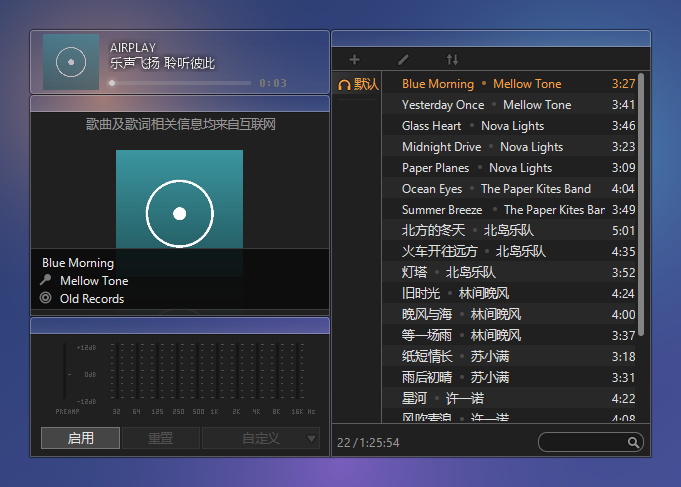
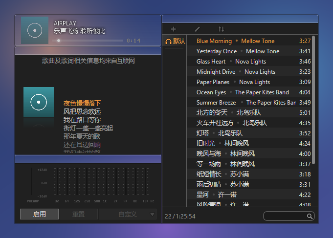
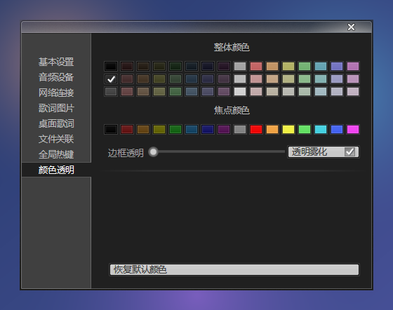

<p align="center"></p>

<h1 align="center">AirPlay3 · Rust 重写版</h1>

<p align="center">一款早已停更的经典本地音乐播放器，用 Rust 让它复活。</p>

> **这是我「经典软件回归计划」的第一步。**
> 计划把那些陪伴过我们、但早已停止维护的 Windows 经典小软件，逐个用现代技术重写，让它们在今天的系统上继续好好用下去。

## 致敬 AirPlay3

AirPlay3 是 2012 年前后的一款国产绿色音乐播放器（airplayme.com）。它体积小巧、无需安装，深色极简的界面由几块磁吸在一起的半透明窗口组成：播放条、歌词图片、均衡器、音乐列表。它的标语是 **「乐声飞扬 聆听彼此」 / 「link between souls」**。

原作者早已停止更新，它依赖的服务器也已全部关闭，但它的界面至今仍让人怀念。本项目没有原版源码，全部功能是对原版程序逆向分析后用 Rust 重新实现的；界面以原版为准逐像素对照复刻（布局、尺寸、颜色、半透明效果），图标、像素数字、标志等全部是照着原版的样子自己画的，不使用原版的图片。谨以此项目向 AirPlay3 的原作者致敬。

## 截图

播放条、标题条是半透明的玻璃（与原版相同），能看到后面的桌面：

| 播放中：大封面 + 歌曲信息 | 约 8 秒后：小封面 + 滚动歌词 |
| :---: | :---: |
|  |  |

「配置 → 颜色透明」：整体颜色、焦点颜色、边框透明、透明雾化



## 已实现

- 原版布局：播放条 + 歌词图片 + 均衡器 + 音乐列表，4 个吸附在一起的分层窗口，尺寸、字体、颜色与原版一致
- 磁性吸附（照搬原版算法）：面板靠近屏幕边、任务栏或其它面板 12 像素内自动对齐；拖播放条整组移动，拖面板标题条可单独拖开，靠近后又吸回去
- 播放条：空闲时显示封面、AIRPLAY 与轮换标语；鼠标悬停淡入音量条、上一首 / 暂停 / 下一首、窗口按钮、面板开关、播放模式
- 半透明玻璃效果与原版相同（按原版实测的逐像素不透明度绘制）：空闲时播放条和各面板标题条几乎完全通透，鼠标悬停时变成浅灰玻璃
- 「配置 → 颜色透明」（原版功能）：整体颜色（48 种）、焦点颜色（16 种）、边框透明（播放条和标题条玻璃的不透明度）、透明雾化（窗口后面的桌面模糊，Windows 10 以上）；改了立即生效
- 歌词图片：大封面 + 歌曲信息浮层，有歌词时切换为小封面 + 同步滚动歌词（当前行橙色）
- 均衡器：前置放大 + 10 段，iTunes 风格预设（流行、摇滚、古典……）
- 音乐列表：分栏、斑马线、多选、拼音首字母搜索（如 `zjl` 搜到 周杰伦）、排序、删除不能播放的内容
- 系统媒体控制：键盘媒体键，Windows 音量浮层 / 锁屏显示标题、艺人、专辑图片
- 原版风格右键菜单、托盘图标、全局热键、拖拽添加、窗口置顶、单实例运行
- 音乐列表、歌词图片可从左 / 右 / 下边和下方两角调整大小，播放条可左右调整宽度（284 ~ 804，按钮随宽度重新排列），被拖动的边自动对齐附近的边
- 「配置」窗口与原版一样（逐像素对照原版截图）：基本设置、音频设备、网络连接（代理）、歌词图片、桌面歌词、文件关联（按格式勾选）、全局热键（可自定义、逐个开关、多媒体键盘）、颜色透明
- 歌词下载：歌词图片右键 →「下载歌词」打开与原版一样的「下载歌词」窗口，自动去掉 `(Live)`、`【六倍音质】` 等干扰再搜，可改标题 / 艺人 / 专辑重新搜索、预览所选的歌词、勾选同时下载专辑图片和艺人图片；也可关联本地歌词、调整歌词快慢
- 歌词来源：两个免费、无需密钥的歌词 API，在「配置 → 歌词图片 → 歌词来源」中选择，默认「自动」同时搜索
  - [LrcAPI](https://docs.lrc.cx)（开源项目 [HisAtri/LrcApi](https://github.com/HisAtri/LrcApi) 的公开实例）：中文歌多，同时提供专辑图片。按其文档，公开实例的数据来自酷狗等平台，可能较慢、不完全准确
  - [LRCLIB](https://lrclib.net)：社区维护的开放歌词库，欧美歌多
  - 也可以[自己部署 LrcAPI](https://docs.lrc.cx/docs/QuickStart)，在「配置 → 网络连接」填地址和密钥
- 专辑图片下载：歌词图片右键 →「下载专辑图片」（LrcAPI，找不到时用 iTunes），或在「配置 → 歌词图片」开启自动下载
- 艺人图片（原版「下载艺人图片」）：没有专辑图片时显示艺人照片，来自 [Deezer 公开 API](https://developers.deezer.com/api)，没有时用中文维基百科的条目配图；按艺人缓存。这两个网站在中国大陆通常要用代理才能访问（程序会用系统代理），连不上时只是不显示艺人图片
- 下载后自动修改歌曲信息（原版选项，默认关闭）：下载歌词时，歌名一致、时长相差 3 秒内才补全空着的艺人、专辑；只改曲库，不改音乐文件
- 只有在手动下载或开启自动下载时，才会把歌名、艺人、时长发送给上面的服务
- 下载的歌词、图片都会保存到本地（`AIRPLAY_CONFIG\LYRIC`、`AIRPLAY_CONFIG\CACHE\COVER`，或自定义歌词目录）并关联到歌曲，下次直接用本地文件
- 迷你条（原版 minibar）
- 桌面歌词：卡拉 OK 填色，8 种预设配色，可锁定（鼠标穿透）
  - 拖动窗口边缘调整大小，窗口拉高时显示的行数自动变多（1 ~ 12 行）
  - 1 行居中；2 行是经典的上左下右交替；3 行以上当前句在中间、前后句越远越淡，换句时平滑滚动
  - 悬停显示工具条（上一首 / 暂停 / 下一首 / 字号 / 配色 / 锁定 / 关闭），右键菜单和「配置 → 桌面歌词」里也能调；锁定后可在主菜单「解锁桌面歌词」
- 任务栏歌词：嵌入任务栏显示当前与下一句。位置可选靠左 / 居中 / 靠右，并能调水平、垂直偏移：直接在任务栏上按住歌词拖动，或在「配置 → 桌面歌词」里填数字
- 播放引擎：无缝衔接、CUE 分轨、WASAPI 共享 / 独占模式、续播上次位置
- 网络流播放（默认隐藏，见下面的「网络电台说明」）：只提供解码、拉流播放的能力；程序里没有任何电台地址，不提供节目源、不整理电台目录，播放的地址都由用户自己粘贴
  - 打开后音乐列表上方有「音乐列表 / 网络电台」两个页签；所有电台清单（包括不同国家 / 地区的）都通过粘贴清单加入，一键粘贴
  - 支持 MP3、AAC / HE-AAC（用 Windows 自带的解码器）直播流和 HLS（m3u8，含 MPEG-TS 分段）；显示当前节目名，断线自动重连
- 格式：MP3 / FLAC / OGG / WAV / AIFF / M4A(AAC、ALAC) / WMA / AC3 / DTS / APE / TTA / WavPack / Musepack / TAK 等；列表文件 m3u / m3u8 / pls / wpl / asx / xspf / ttpl / apl
  - APE、TTA、WavPack、Musepack、TAK、DTS 用自带的纯 Rust 解码器，与 ffmpeg / 官方解码器逐样本一致
  - APE（Monkey's Audio）：3.80 起的所有版本、5 个压缩级别、8 ~ 32 位、浮点、多声道
  - WavPack：8 ~ 32 位整数、32 位浮点、无损和混合（有损）模式、多声道；不支持 .wvc 修正文件和 DSD
  - Musepack（.mpc）：SV7 和 SV8，无缝播放信息、跳转与官方解码器一致
  - TAK：官方编码器 2.3.3 的所有预设，8 / 16 / 24 位、最多 6 声道、8 ~ 192 kHz
  - DTS：.dts、.dtshd（无缝播放），以及 CD 上常见的装在 WAV 里的 DTS（自动识别）；5.1 核心和 6.1 / 7.1（XCH、XXCH）、96 kHz（X96）、高码率（XBR）扩展；DTS-HD Master Audio 无损（最多 8 声道、192 kHz、24 位）。与 `ffmpeg -flags bitexact` 逐样本一致
- 本地歌词：LRC（GBK / UTF-8 自动识别、乱码修复、模糊匹配文件名），内嵌歌词与封面

## 尚未完成

- 原版的在线服务（电台、歌词、图片、自动更新）早已关闭：歌词、图片已换成上面说的开源服务；电台不提供节目源，只能播放用户自己粘贴的地址
- 不支持 DTS Express（蓝光上的画评音轨等用的低码率格式）

## 使用

到 [Releases](../../releases) 下载 `AirPlay3.exe`，直接运行即可，无需安装。

- 与原版一样是绿色版：配置、曲库和歌词保存在程序旁边的 `AIRPLAY_CONFIG` 文件夹；该位置不可写时改用 `%APPDATA%\AirPlay3`。也可以在「配置 → 基本设置」最下面一行改存到操作系统默认位置或其它文件夹（现有数据会复制过去）
- 命令行：`AirPlay3.exe 文件或文件夹...` 打开并播放；`--tray` 启动时最小化到托盘
- 右键播放条或托盘图标打开主菜单（迷你歌词、桌面歌词、任务栏歌词、配置都在这里）；窗口拖到看不见的地方时点「恢复默认位置」；右键歌词图片可下载歌词和专辑图片
- 把音乐文件或文件夹拖进窗口即可添加

## 网络电台说明

> 本项目为开源音频播放器，仅用于本地开发技术研究；不含任何广播源。用户自行输入网络流地址，源内容合法性由用户自行承担；禁止用于违规转播广播电视节目。

- 默认隐藏，界面上没有入口。要用时先退出 AirPlay3，打开配置目录（默认是程序旁边的 `AIRPLAY_CONFIG` 文件夹）里的 `config.json`，把 `"radio"` 里的 `"enabled": false` 改成 `true`（没有这一项就加上 `"radio": { "enabled": true }`），保存后重新运行
- 打开后：音乐列表上方的「网络电台」页签，或主菜单「网络电台」
- 加电台：复制一份电台清单，点工具栏的「粘贴电台清单」（或按 Ctrl+V）。支持：
  - M3U / EXTM3U（`#EXTINF` 后面的名字；`group-title` 不同的分到不同的清单，`tvg-logo` 作为图片）
  - PLS（`File1=` / `Title1=`）
  - 文本：每行 `名字,地址`（也可以用空格、竖线、制表符隔开，或只有地址）；`分组名,#genre#` 这一行开始一个新的清单
- 只接受 http / https 地址；同一个地址不会重复添加。左边一栏是清单，双击电台播放，上一首 / 下一首在当前清单里切换；右键可复制地址、删除电台或整个清单

## 从源码构建

需要 Rust（`x86_64-pc-windows-gnu` 工具链）和完整的 MinGW-w64（提供 dlltool / windres）。

```bash
cp .cargo/config.example.toml .cargo/config.toml   # 按本机修改 MinGW 路径
cargo build --release
```

## 许可

代码以 [MIT](LICENSE) 协议开源；界面上的图标、像素数字、标志都是在程序里自己画的（`src/skin/`），同样是 MIT。

APE、WavPack、Musepack 解码器分别改写自 Monkey's Audio SDK、WavPack 参考库、libmpcdec（都是 BSD 许可）。TAK、DTS 解码器改写自 FFmpeg，所在目录 `src/audio/codec/tak/`、`src/audio/codec/dts/` 以 [LGPL 2.1](LICENSE-LGPL-2.1.txt) 或更新版本发布（其余代码仍是 MIT）。各项声明见 [THIRD-PARTY-NOTICES.txt](THIRD-PARTY-NOTICES.txt)，发布包中也附带这些文件。
